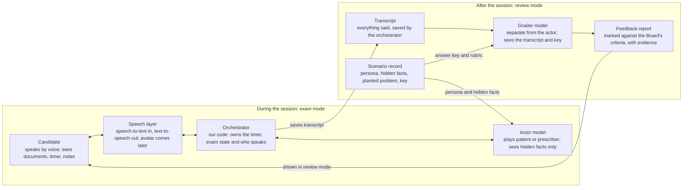

# Vivascript — MVP Plan

Oct 12, 2026 · @Manojvradan

## Overview

Vivascript lets a pharmacy intern rehearse the Pharmacy Board of Australia oral exam by voice against an AI examiner that stays neutral during the session and marks the performance afterwards. The MVP covers Part C only (problem solving and communication, 20 minutes, open book).

The MVP succeeds if:

- one tester completes a full 20-minute Part C role play without the persona breaking character or leaking answers;
- 10 original scenarios have been reviewed by a pharmacist;
- a pharmacist reading the feedback reports agrees with the grader's main findings on most sessions (agreement target to set with the reviewer);
- interns in a pilot cohort say they would pay for it, which we test by asking, not by assuming.

## Users and problem

Interns sit the oral exam after completing about 75% of their supervised practice hours, in three sittings a year (February, June, October), and often have few chances to rehearse with someone who plays a patient and a prescriber realistically. Secondary sources suggest roughly 1,000 to 1,500 candidates sit it each year; confirm with the Board.

| Group | Role in the MVP |
| --- | --- |
| First tester | A pharmacy student who judges realism and clinical accuracy while we build |
| Pilot cohort | 20 to 50 interns before one exam sitting, recruited through the tester's network |
| Pharmacist reviewer | Signs off every scenario and calibrates the grader (to be recruited) |

The problem we solve: candidates get too little realistic, timed, no-hints practice, and little structured feedback against the Board's own criteria.

## MVP scope

The MVP is a voice-only Part C simulator with a post-session feedback report. Everything else waits until that loop works.

| Feature | MVP | Later |
| --- | --- | --- |
| Part C role play with patient/agent and prescriber personas | Yes |  |
| Voice in and out (speech-to-text, text-to-speech) | Yes |  |
| Prescription and dispensing history shown as documents | Yes |  |
| 20-minute timer, no returning to a finished part | Yes |  |
| Exam mode (neutral, no hints) and review mode (feedback) | Yes |  |
| Feedback report graded against the Board's criteria | Yes |  |
| Own offline references used off-screen (no in-app reference panel) | Yes |  |
| Session history list | Basic | Progress by competency |
| Avatar video |  | Yes |
| Part A primary healthcare role play |  | Yes |
| Part B legal and ethical drills |  | Yes |
| Full 35-minute mock exam |  | Yes |
| Cohort dashboard, SSO, multi-tenant admin |  | Yes |

## User flow

A session runs in two modes: exam mode is neutral and scripted, and review mode shows feedback only after the timer ends.

1. The candidate signs in and starts a scenario, chosen at random or by problem type.
2. A question sheet appears with the prescription and the pharmacy's dispensing history. The 20-minute timer starts when she presses start.
3. She takes the patient's or agent's history by voice. The patient persona reveals hidden facts only when asked the right questions.
4. She can phone the prescriber. The prescriber persona answers like a busy clinician and needs a clear recommendation.
5. The examiner voice stays neutral and gives only time checks. Nothing signals whether an answer was good.
6. At 20:00 the session closes and cannot be reopened.
7. Review mode shows the transcript, the graded report, the facts she missed and a model resolution.
8. She can replay the same scenario later with different hidden facts.

## Architecture

The actor model plays the role from the scenario record, the orchestrator owns timing and state, and a separate grader marks the saved transcript after the session ends.

During the session the candidate talks through the speech layer to the orchestrator, which passes turns to the actor. After it, the grader reads the transcript and the full answer key and writes the feedback report.

Design rules:

- The actor sees only its persona and the facts it may reveal, and never confirms or corrects an answer.
- The orchestrator, not a model, ends each part when the timer runs out.
- Clinical and legal facts come from the scenario record, not from the model's memory.
- LiveKit Agents or Pipecat can run the voice loop, and an avatar can be added later at the speech layer.

## Scenarios

Every scenario is a structured record with fixed facts, and the LLM improvises only the dialogue. We write 10 original scenarios: one for each of the nine problem types in the Board's guide, plus one that combines two problems.

| Field | Contents |
| --- | --- |
| Setting | Community or hospital; state or territory if law-specific |
| Documents | The prescription and the dispensing history, rendered as images or PDFs |
| Patient or agent persona | Age, manner, health literacy |
| Public facts | What the persona says unprompted |
| Hidden facts | Revealed only if asked: other medicines, allergies, pregnancy, adherence |
| Planted problem | One of: interaction, contraindication, inappropriate drug or dose, doubling up, unintended change in dose, unintended change in medication, multiple prescribers, drug-induced illness, monitoring |
| Acceptable resolutions | The range of safe outcomes |
| Unacceptable actions | Actions that would trigger a fail condition |
| Prescriber persona | Manner and how hard they push back |
| Counselling checklist | Points the candidate should cover |
| Sources | References used for the clinical and legal facts |
| Review status | Reviewer, date, version |

**Worked example (original; needs pharmacist review before use).** A 68-year-old man collects a new script for brand-name atorvastatin 40 mg, written on hospital discharge. The pharmacy history shows generic atorvastatin 40 mg dispensed two weeks ago by his GP. The planted problem is doubling up under a different brand.

- Public facts: he says the hospital changed his cholesterol tablet.
- Hidden facts: he still has the generic at home, nobody told him to stop it, and he takes warfarin and sometimes forgets doses.
- Acceptable resolutions: explain both are the same drug, confirm what he takes now, clarify intent with the hospital or GP, supply once clarified, and counsel against taking both.
- Unacceptable: dispensing without raising the duplication, or telling him to take both.
- Prescriber: a busy GP who assumes the hospital only wrote the brand and needs a clear recommendation.

## Grading and feedback

A separate grader model marks each session against the Board's own criteria, quotes the transcript for every judgement, and never plays a role in the session.

The report contains:

- **The four fail conditions from the Board's guide**, each marked pass or fail with evidence: serious harm or injury to a patient; risk not reasonably minimised or therapy not optimised; failing to practise legally and professionally; not demonstrating reasonable factual knowledge.
- **Competency evidence checklist** adapted from Appendix 1 of the guide: relevant history obtained, issue identified, options considered, prescriber contacted appropriately, clear counselling, corrective action taken promptly.
- **Missed facts:** hidden facts she never asked about, such as a second medicine or pregnancy.
- **Counselling check:** dose, timing, side effects, what to watch for, when to return.
- **Two or three moments to replay** from the transcript, with a model resolution beside them.

Calibration: a pharmacist grades the same first 10 sessions blind, and we compare their marks with the grader's before trusting it. Disagreements become fixes to the rubric, not to the model's tone.

## Accuracy, safety and legal

No scenario or grading rubric enters the bank until a pharmacist has reviewed it, because language models can state doses and legal requirements confidently and wrongly.

- **Clinical truth lives in the scenario record,** grounded in vetted sources (AMH, Australian Pharmaceutical Formulary, the Poisons Standard, state and territory legislation, PBS), never in the model's memory.
- **Original content only.** Candidates should not share real exam questions, so every scenario is written from the structure in the Board's guide, not from recalled exam content.
- **No implied endorsement.** The app states clearly that it is not affiliated with Ahpra or the Board and does not predict results.
- **Privacy.** Voice recordings and transcripts are personal data. Decide retention, deletion and where data is hosted before the pilot, and tell users in plain language.
- **Version control.** Each scenario carries a reviewer, date and version, and the exam format is rechecked against the Board's current guide before each sitting.

## Costs and metrics

A voice-only 20-minute session should cost roughly $1 to $3, and about $2 to $10 once an avatar is added. These are my estimates from vendor per-minute prices seen in October 2026, not quotes, so measure real costs in the pilot.

| Setup | Approx. cost per minute | Per 20-minute session |
| --- | --- | --- |
| Voice only (speech-to-text, LLM, text-to-speech) | $0.05 to $0.15 | $1 to $3 |
| With avatar video | $0.10 to $0.50 | $2 to $10 |

We track these in the pilot:

- sessions started and completed;
- end-to-end response delay per turn (about two seconds is typical for current avatar stacks; set our own target after testing);
- cost per session, logged from provider usage;
- grader agreement with the pharmacist reviewer;
- tester and intern ratings of realism, and whether they would pay and how much.

## Milestones

Build the content and the grader before the voice and video, because the scenarios and feedback are the product. Each step has a gate that must pass before the next begins.

1. **Scenario bank.** Write and review 3 scenarios first, then 10. Gate: a pharmacist signs off each one.
2. **Text-only loop.** Actor persona, prescriber persona, timer and grader running in a chat window. Gate: a full Part C session works end to end without the persona leaking answers.
3. **Grader calibration.** Pharmacist grades the same sessions blind. Gate: the team agrees the grader's findings are trustworthy enough to show candidates.
4. **Voice.** Add speech-to-text and text-to-speech and measure delay per turn. Gate: the role play still feels usable.
5. **Document viewer and exam UI.** Prescription, dispensing history, question sheet, timer, review mode.
6. **Pilot.** 20 to 50 interns before one sitting, logging usage, cost per session and feedback. Gate: clear evidence on willingness to pay.
7. **Avatar and Part A and B,** only if the pilot supports it.

## Task tracker

Tick items off as they finish. The groups follow the milestones above.

**Scenario bank**

- [ ] Check the current candidate guide on the Pharmacy Board's site
- [ ] Recruit a pharmacist reviewer
- [ ] Write 3 original scenarios and get them signed off
- [ ] Write the remaining 7 scenarios

**Text-only loop**

- [ ] Actor prompt with hidden-fact handling
- [ ] Prescriber persona
- [ ] Orchestrator with timer and part state
- [ ] Grader prompt covering the four fail conditions

**Grader calibration**

- [ ] Pharmacist grades the first 10 sessions blind, then compare with the grader

**Voice and UI**

- [ ] Choose speech and LLM providers, including a data-retention policy
- [ ] Measure end-to-end delay per turn
- [ ] Document viewer, question sheet, timer and review mode

**Pilot**

- [ ] Interview 10 to 15 recent interns about what they used and paid
- [ ] Recruit 20 to 50 interns for one sitting
- [ ] Log sessions, cost per session and feedback
- [ ] Run a trademark and domain check on the name

## Risks and open questions

The biggest risk is clinical accuracy, and the biggest unknown is whether interns will pay.

| Item | Why it matters | Next step |
| --- | --- | --- |
| Exam format may have changed | The guide we hold is the January 2021 version (1,824 hours, "Part 4" wording); 2026 sources describe a 1,575-hour internship | Check the current guide on the Pharmacy Board's site before writing scenarios |
| No pharmacist reviewer yet | Scenarios and grader need independent sign-off | Recruit one reviewer beyond the first tester |
| Latency | Slow replies break the role play more than anything else | Measure end-to-end delay in the text-to-voice prototype |
| Provider and data residency | Student voice data is personal data | Choose speech and LLM providers with a retention and hosting policy we can state |
| Competing prep courses | Human-led mock orals with examiner feedback already exist | Interview 10 to 15 recent interns on what they used and paid |
| Project name | No exact match for "Vivascript" in a quick search, but similar names exist in health (VitaScript, Vitalscript) | Run a proper trademark and domain check before branding |
